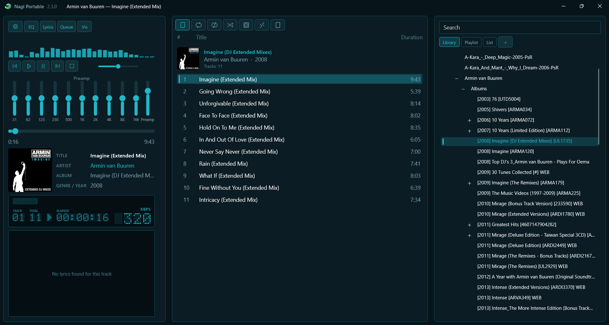

<div align="center">
  

# Nagi Portable

  **A portable fork of [Nagi](https://github.com/Anthonyy232/Nagi): no installer, no Store identity, everything in one folder.**

<div align="center">
    
    
    
</div>

</div>

<br>

Nagi Portable is an unofficial fork of [Nagi](https://github.com/Anthonyy232/Nagi) by Anthonyy232, a local music player for Windows built with C# and WinUI 3. The fork keeps Nagi's scanner, database, playback engine and lyrics, but runs as a portable app and replaces the main window with a classic three-column player layout.

This fork is not affiliated with the original project. Please report problems with this build here, not upstream.

> [!IMPORTANT]
> **How the portable build differs from regular Nagi**
>
> | | Nagi (Store / installer) | Nagi Portable |
> |---|---|---|
> | Install | Microsoft Store or setup program | Unzip anywhere writable and run `Nagi.exe` |
> | Your data | Hidden Windows app-data folder | `datadir` folder next to `Nagi.exe` |
> | Updates | Automatic | Unzip the new version over the old one; `datadir` and `portable.json` are kept |
> | Remove | Uninstall in Windows | Delete the folder |
>
> **Reset to a clean state**
>
> 1. Quit Nagi completely. By default, closing the window only hides Nagi to the tray, so use **Exit** in the tray icon menu.
> 2. Delete the whole `datadir` folder. Do not delete single files from it: `nagi.db-wal` holds the latest database changes and belongs with `nagi.db`.
> 3. Start `Nagi.exe`. A fresh `datadir` is created and Nagi opens with the first-run screen.
>
> `datadir` holds everything Nagi writes: library database, playlists, history, settings, caches and logs. Delete it before you share your copy of Nagi with someone else. The only thing kept outside it is the **Launch at startup** option, a value under `HKCU\Software\Microsoft\Windows\CurrentVersion\Run`. Turn that option off in Settings before you reset or remove Nagi if you have enabled it.

## 🔀 What changed in this fork

### Portable instead of installed

- Runs unpackaged: no MSIX package, no Microsoft Store identity, no installer. The published folder is self-contained and includes the .NET and Windows App SDK runtimes.
- Everything Nagi writes goes to `datadir` beside the executable: `nagi.db`, `settings.json` (replaces Windows `LocalSettings`), `playback_state.json`, album art, lyrics cache and logs. Nothing goes to `%LocalAppData%`.
- The data folder can be moved with `--datadir <path>` or a `portable.json` file (see [Download](#-download)). The override survives restarts and is written into the autostart command.
- If the data folder cannot be created or written (for example under `Program Files`), Nagi shows an error and exits instead of silently writing somewhere else.
- **Launch at startup** uses the current-user `Run` registry key instead of a packaged startup task.

### New main window

- One window with three columns replaces the side navigation and the floating bottom player:
  - **left:** buttons for settings, equalizer, lyrics, queue and visualizer; the visualizer; Previous / Play / Pause / Next / Stop and volume; 10-band equalizer with preamp; seek bar; cover art and track info (title, artist, album, genre, year); queue status (lossless or lossy, track N of M, elapsed or remaining time, bitrate); the lyrics of the playing track;
  - **middle:** playback order and the tracks of the selected tree node. Folders and artists are grouped under album headers; playlists keep their own order;
  - **right:** search and a tree with three tabs: **Library** (folders), **Playlists** (including smart playlists) and **Artists**.
- Double-click a tree node to play it. The context menu has Play, Play recursively, Add to queue and Add recursively.
- Shuffle and repeat are replaced by one **playback order** with six modes: Default, Repeat playlist, Repeat track, Shuffle tracks, Shuffle albums, Random.
- The track list can show the tag title or the file name.
- The last selected tree node is restored on startup.
- One dark cyan theme with fixed colors. The Library, Albums, Genres and Insights pages are no longer reachable from the window.
- Settings and lyrics open as overlays. The mini-player, tray popup and Windows media controls are kept.
- **Lyrics panel:** the lyrics of the playing track are shown as plain text below the status display and fill the rest of the left column. They come from a `.lrc` or `.txt` file with the track's name next to it or, without one, from the lyrics tag; the panel never goes online. Click the text to open the full lyrics view. A lyrics file put next to a track after the library was scanned is found without a rescan, in the panel and in the full view.
- A dark title strip replaces the Windows title bar. It shows the app name, the version and the loaded track (artist and title), and holds the minimize, maximize and close buttons. The window can also be moved by dragging any empty spot, and double-clicking an empty spot maximizes or restores it.

### Playback

- **Track transitions:** the next queue item is prepared in LibVLC while the current item plays, including CUE tracks inside one file. Listen-history writes run in the background. Manual track selection and Stop cancel obsolete preparation so a late automatic transition cannot override the user's choice.
- **Real spectrum visualizer.** The 28 bars in the top-left panel show the spectrum of the playing track, from 40 Hz to 11 kHz, in step with the playback position. When a track starts, FFmpeg decodes it in the background at low priority: the first bars are ready at once, and a four-minute song is done in about a second on a laptop i3. Nothing is written to disk. The spectrum of the current track is kept in memory (about 150 KB) and dropped when the next track starts or the visualizer is hidden. The bars show the file itself, so volume, ReplayGain and the equalizer do not change them. Without [FFmpeg](https://ffmpeg.org/download.html) on the `PATH`, or for a file FFmpeg cannot read, the bars play a decorative animation instead.
- **Unplayable files are skipped.** When a file cannot be played, Nagi moves on to the next track the way the Next button does, also in Repeat track mode. If nothing in the queue plays, it stops after one pass (at most ten files in a row) instead of retrying the same file.

### Library and tags

- **CUE albums:** a single audio file with a single-file `.cue` sheet next to it appears as separate tracks, with their own titles, durations, seeking and queue navigation. Rescan an existing library to pick up CUE sheets. UTF-8 and legacy Cyrillic encodings are supported; embedded CUE sheets and multi-file CUE albums are not yet supported.
- **Album editions:** editions of the same album in separate folders get separate groups with folder labels and consistent track/queue order when browsing a parent folder.
- **Library refresh:** registered music folders are checked once at startup. During the session, use the folder menu's **Rescan** command to pick up added, changed or removed music files and subfolders. Nagi does not watch folders or periodically rescan them while running. The folder tree and track list refresh after a scan; disconnected drives stay in the library during the startup check.
- **Russian tags:** ID3 text written in Windows-1251 but stored as Latin-1 is detected and decoded correctly. A Cyrillic file name counts as an extra hint.
- **Missing tags:** when artist or title is missing, they are taken from the file name: the track number is dropped and `Artist - Title` is split at a spaced dash. If the name has no such dash, it becomes the title and the artist is taken from the top folder under the library root.
- Album and artist images are stored as the original bytes. ImageSharp is removed, so images are no longer resized and no colors are extracted from them.

### Removed

- Last.fm (sign-in, scrobbling, artist info), ListenBrainz and Discord Rich Presence.
- Artist images and biographies from Last.fm, TheAudioDB and Fanart.tv, and the API key service they needed.
- Microsoft Store APIs.
- Settings that no longer affect the window: theme, accent color, window material, player styling, navigation pane state and items, player buttons, collapsible player, and online artist metadata from MusicBrainz.

Still online when you enable it: lyrics from LRCLIB and NetEase.

## ✨ Features

- **Lyrics**: Read the lyrics of the playing track in the main window, from the lyrics tag or a `.lrc` file. Click them to open the full view, where synced lyrics follow the song and tapping a line jumps to that moment.
- **Resizable Mini-Player**: An always-on-top mini-player with playback controls and album art.
- **Folder-Based Library**: Add your music folders and browse your collection. Update the library at startup or with **Rescan**.
- **Playlists & Smart Playlists**: Create custom playlists or rule-based smart playlists that update as your library grows.
- **Queue Management**: Drop files or folders onto the queue panel to add them to the queue without importing them into your library.
- **10-Band Equalizer**: Shown in the main window (it can be hidden), with pregain control.
- **Spectrum Visualizer**: Bars computed from the playing track with FFmpeg; see [What changed](#-what-changed-in-this-fork).
- **Volume Normalization**: ReplayGain support keeps volume consistent across your library. Analysis needs [FFmpeg](https://ffmpeg.org/download.html) on the `PATH`; it is not included in the zip, and Nagi explains how to install it when you turn normalization on.
- **System Tray & Media Controls**: Control playback from the tray popup or with Windows media keys and transport controls.
- **Wide Format Support**: MP3, FLAC, AAC, OGG, WAV, AIFF, APE, DSD, M4A, WMA, WavPack, and more.
- **CUE Albums** and **Cyrillic tag recovery**: see [What changed](#-what-changed-in-this-fork).

## 📥 Download

Nagi Portable ships as a self-contained `win-x64` zip. Extract it to any folder you can write to and run `Nagi.exe`. Your data is stored in `datadir` beside the executable.

Optional overrides:

- `--datadir <path>`: use a custom data folder.
- `portable.json` next to the exe: `{ "DataDirectory": "D:\\NagiData" }` (the key `datadir` is also accepted). Zip updates do not overwrite this file.

## 🌍 Localization

Translations come from the original Nagi project on [Crowdin](https://crowdin.com/project/nagi). The text this fork adds to the main window is machine-translated and not yet checked by native speakers; Afar and Acholi show it in English.

## 🛠️ Technologies

- **[C#](https://docs.microsoft.com/en-us/dotnet/csharp/)** & **[.NET 10](https://dotnet.microsoft.com/)**
- **[WinUI 3](https://docs.microsoft.com/en-us/windows/apps/winui/winui3/)** in **[Windows App SDK](https://github.com/microsoft/WindowsAppSDK)**
- **[LibVLCSharp](https://github.com/videolan/libvlcsharp)**: audio playback and format support.
- **[Community Toolkit for WinUI](https://github.com/CommunityToolkit/WindowsCommunityToolkit)** and **[Community Toolkit MVVM](https://docs.microsoft.com/en-us/dotnet/communitytoolkit/mvvm/)**
- **[Entity Framework Core (SQLite)](https://docs.microsoft.com/en-us/ef/core/)**: local database.
- **[ATL (Audio Tools Library)](https://github.com/Zeugma440/atldotnet)**: reading audio metadata and CUE sheets.
- **[LrcParser](https://github.com/OpportunityLiu/LrcParser)**: parsing LRC lyrics files.
- **[MaterialColorUtilities](https://github.com/material-foundation/material-color-utilities)**: color schemes.
- **[H.NotifyIcon.WinUI](https://github.com/HavenDV/H.NotifyIcon)**: tray icon.
- **[Serilog](https://serilog.net/)**: logging.
- **[XAML Behaviors](https://github.com/Microsoft/XamlBehaviors)**: declarative UI behaviors.
- **[Microsoft Dependency Injection](https://docs.microsoft.com/en-us/dotnet/core/extensions/dependency-injection)**

*Thanks to Anthonyy232 for Nagi, and to the creators and maintainers of all the open-source libraries it is built on.*

## 🚀 Build from Source

### Prerequisites

- Visual Studio 2022 or later with the **".NET Desktop Development"** workload
- .NET 10 SDK

### Steps

1. Clone this repository and open `Nagi.sln` in Visual Studio.
2. Set the Solution Platform to `x64`.
3. Press `F5` or click **▶ Nagi (Unpackaged)** to build and run.

To publish the portable folder:

```bash
dotnet publish src/Nagi.WinUI/Nagi.WinUI.csproj -c Release -r win-x64 --self-contained -p:Platform=x64 -p:WindowsPackageType=None -p:WindowsAppSDKSelfContained=true -o out/win-x64
```

Use `out/win-x64` as the single local publish directory and update it in place for each version. Build release archives from this directory instead of creating a separate publish folder for each release.

Data is written to `<publish-dir>/datadir`, so the folder next to `Nagi.exe` must be writable. Before packaging, check for `datadir` and `portable.json` and exclude them from the archive if present; keep any existing user data on disk.

### Development

To add a database migration:

```bash
dotnet ef migrations add <name> --project src\Nagi.Core --startup-project src\Nagi.Core --context MusicDbContext --no-build
```

## ❤️ Support the original author

Nagi is created by Anthonyy232. If you like it, consider supporting the original project:

<div align="center">
  <a href="https://github.com/sponsors/Anthonyy232"></a>
</div>

## 📄 License

Like the original Nagi, this fork is licensed under the **GNU General Public License v3.0**. See the [LICENSE](LICENSE) file for details. The changes made in this fork are listed in [What changed in this fork](#-what-changed-in-this-fork).
